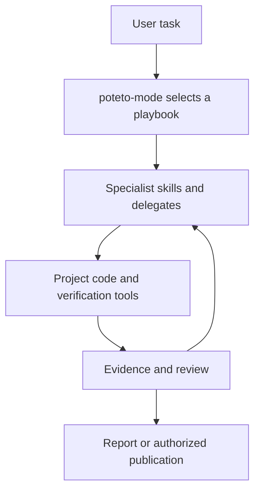

# pstack and the post-PR-15 engineering workflow

Research date: 2026-10-19, Asia/Singapore. This is a source-grounded assessment and a set of proposals, not an accepted design or an implementation change.

## Conclusion

pstack is a substantial, opinionated engineering workflow system built around a routing skill, task playbooks, specialist skills, executable helpers, and host-specific capabilities. Its most useful contribution is the conversion of broad advice into concrete actions and evidence requirements. The current `agent-coding` engineering package already incorporates much of that approach. Replacing our package or reproducing pstack's command inventory would add duplication without demonstrated benefit.

The strongest candidates for further adaptation are:

1. A concrete procedure for checking performance claims, including whether the measured work happened and whether the load generator was the bottleneck.
2. A focused check of the assumption on which a change's safety depends, using real code across boundaries that a symbol search misses.
3. An optional formal-verification method with explicit model-to-code correspondence, assumptions, bounds, negative controls, and maintenance.
4. Better handoff to the human after long work: every pending decision must be independently understandable and supported by evidence.
5. Narrower, task-specific guidance for trace analysis, visual equivalence, and repeated optimization when a real project needs it.

Keep our existing ownership, authorization, release, and host-qualification contracts. Treat pstack's mandatory delegation, model defaults, persistent orchestrator state, and publication conventions as environment-specific choices. None of the evidence reviewed establishes that the complete pstack workflow outperforms the complete engineering workflow on matched tasks.

## Baselines and evidence

| Item | Verified identity |
|---|---|
| Upstream | `cursor/plugins` main at `6b78e9f4e46c75d1697d837e51f07c2692e60b24` |
| Upstream commit time | 2026-10-19 01:51:15 UTC, or 09:51:15 Singapore time |
| Manifest version | `0.15.27`; the snapshot includes changes after the commit that raised the version |
| Local comparison | `agent-coding` at `49896fe6c833c28f82a474ab1de9044256b5e319` |
| PR baseline | [PR #15](https://github.com/LaChimere/agent-coding/pull/15), merged into that exact local commit |
| Scope | Full pstack capability families, selected implementation helpers, host adapters, published evidence, and comparison with current engineering methods |

The upstream snapshot was obtained from the GitHub API and downloaded into an isolated temporary directory. The research used three bounded background investigations: orchestration; verification/review/learning; and distribution/evidence. The primary researcher inspected the decisive sources, communication methods, current local contracts, and the final synthesis. Upstream instructions were treated as research material, not executed as authority.

Supplementary Exa searches covered workflow/effectiveness evidence, the formal-verification revision, and official verifier semantics. Three successful searches returned 15 result slots; an earlier schema-invalid call returned no results. Search snippets were discovery aids. The report relies on the pinned source, first-party PR descriptions, official tool documentation, and the current local files. It does not use a third-party summary as evidence of effectiveness.

Evidence levels used here:

- **Inspected:** the behavior is specified by source or documentation.
- **Executed:** a named check ran during this research and produced the stated result.
- **Author-reported:** a first-party report describes an experiment whose underlying runs were not independently inspected.
- **Proposed:** an adaptation or experiment inferred from the comparison.

The report does not claim native Cursor/Claude acceptance, a production deployment, a model-quality ranking, or a comprehensive security audit.

## 1. The system has several distinct layers

The inspected tree contains **55 core skills: 31 commands and 24 principle skills; 23 playbooks; and two agent definitions**. Benny contributes three additional dormant automation skills outside that core inventory. Source inspection and the docs checker confirm the core counts; the separate generated-tree check confirms the Claude copy agrees with the generator. Benny's README explicitly describes its sources as dormant. [Source overview][overview] [Benny][benny]

The playbook is a task recipe. A skill provides a reusable method. The host runs tools, agents, and schedules. A project-specific verification skill teaches the agent how to operate and check the actual product. Confusing these layers leads to claims such as "the skill exists, so the project can be verified" or "the adapter exists, so the host has been qualified."

`poteto-mode` makes the receiving chat own the playbook and delegation. `poteto-agent` is a delegate wrapper, not a second coordinator for the entire task. The main mode routes task types to explicit sequences and requires the selected steps to enter the task list. Its principle index gives shared rules a discoverable owner. This is intended to reduce the chance that the agent remembers a slogan but misses the concrete method; that benefit was not measured here. A larger default sequence also carries additional maintenance and context requirements. [Mode][mode] [Delegate][delegate]

Our current design instead exposes nine lifecycle entry points plus `spar` and `rubber-duck`, with task-specific references behind them. It explicitly rejects mandatory stages, a fixed model roster, and a universal scheduler. This is a deliberate product difference, not evidence of missing rigor. [Our design](design.md) [Preservation map](alignment.md)

## 2. Discovery, understanding, and design

### Reconstruct behavior and rationale separately

`how` traces implementation behavior. `why` reconstructs the pressures and decisions behind it using source history and available evidence categories such as issue trackers, team discussions, incidents, and analytics. `recall` combines recent task history with current shared records, while `teach` turns behavior and rationale into a reader-paced explanation. [How][how] [Why][why] [Recall][recall] [Teach][teach]

The valuable distinction is between "what the code currently does," "why it was designed that way," and "what we most recently decided." A comment, a recent commit, and an old chat are different evidence. `recall` also requires rechecking surfaced branches and PRs rather than treating historical transcripts as current state.

The cost is that `why` normally fans out across all available evidence categories and uses a separate synthesizer. It even selects writable agent mode to retain Cursor MCP access while telling investigators not to write. That is a Cursor-specific capability workaround. Our portable method should retain the evidence distinction and scope-sensitive source selection, not copy a writable-mode setting as a universal read-only investigation pattern. Our `understand-codebase` already calls for code, history, runtime evidence, and explicit uncertainty. [Our understanding method](../../plugins/engineering/skills/understand-codebase/SKILL.md)

### Start with callers and data shape

`architect`, the domain/type principles, and `typescript-best-practices` push design toward caller usage, ownership, discriminated variants, boundary parsing, and fewer hidden obligations. `arena` compares attempts at the same problem; `swarm` partitions different work. These solve different uncertainties: comparing alternatives is not the same as parallelizing an agreed implementation. [Architect][architect] [Arena][arena] [Swarm][swarm] [TypeScript][typescript]

Our design and change-quality methods already retain these concerns. The useful addition is a clearer distinction between a design experiment, a competing implementation, and ordinary parallel execution when a task actually calls for one. There is no reason to require multiple prototypes for familiar small changes or to introduce a public command for every distinction. [Our design method](../../plugins/engineering/skills/design-solution/SKILL.md) [Change quality](../../plugins/engineering/references/change-quality.md)

### Prove the assumption that makes a change safe

`blast-radius` goes beyond enumerating direct callers. It asks which one or two facts the safety argument depends on, follows serialized data, dependency implementations, lifecycle ordering, and downstream consumers, and seeks a test or script against the real code. Its evidence progression distinguishes an assertion, a source citation, a reachability argument, executable evidence, and a running-app reproduction. [Blast radius][blast]

This is a useful concrete technique inside our existing review and verification methods. For example, "deleting this cache entry cannot dispose a live resource" deserves inspection of the dependency version and actual disposal behavior. Counting references cannot establish that claim. The proposed adaptation is a question and an appropriate check, not a new mandatory report or an assumption that every change has exactly one safety fact.

## 3. Verification is a reusable project capability

### Real product behavior

`create-verification-skill` discovers how the actual project starts and becomes usable, how an agent can drive it, what side effects prove success, and how to clean up only owned resources. It generates launch, doctor, drive, evidence, cleanup, and helper guidance plus a feature map. The generator must exercise the instructions before claiming they work. `maintain-verification-skill` combines source inspection with live coverage and separates documentation drift from real product regressions. [Creation][verify-create] [Maintenance][verify-maintain]

Our PR-15 workflow already incorporates this capability. The local evidence contract further distinguishes product outcomes from verification-tool failures during setup, execution, cleanup, and evidence persistence, preserving the product verdict even when later cleanup fails. It specifies distinct CLI tool-error outcomes and checks of claimed helper error boundaries. That distinction directly addresses our recorded Grok acceptance problem. Do not replace it with a simpler undifferentiated pass/fail result when borrowing upstream material. [Our evidence contract](../../plugins/engineering/references/verification-evidence.md) [Grok acceptance](grok-acceptance.md)

### Formal verification

The new generator selects a valuable property, chooses a suitable tool, relates the model to actual code, and creates a reusable project verification skill. For event-order questions, current guidance defaults to TLA+. For code-level properties, it prefers a verifier that operates on the language. If no such verifier is available, it explicitly directs generated-input tests against the real implementation instead of a handwritten substitute. [Formal generator][formal]

Three claims must remain separate:

| Result | What it can establish |
|---|---|
| Model checker completes on a defined model | The checked property holds within that model and configuration, subject to the tool and modeling assumptions |
| Code verifier completes within stated assumptions and bounds | The checked code satisfies the encoded claim for that scope; the chosen harness and assumptions still matter |
| Generated-input tests pass | The tested implementation passed those inputs; this is not an exhaustive formal proof |

TLC's official documentation describes explicit-state checking of TLA+ specifications, especially finite systems. Kani's loop tutorial explicitly warns that checking up to one problem size does not establish correctness at larger sizes. These are reasons to report the actual verification configuration, not reasons to dismiss the tools. [TLC documentation](https://docs.tlapl.us/using:tlc:start) [Kani bounds](https://model-checking.github.io/kani/tutorial-loop-unwinding.html)

The strongest upstream requirement is that the generated workflow must detect a temporary change that breaks the property in real code. For a separate TLA+ model, mutating implementation code does not automatically change the model. Therefore a trustworthy project workflow needs an explicit correspondence and drift check, or must report that code-level sensitivity is unproven. A passing stale model is insufficient. This is a research inference about how to satisfy the upstream contract, not a claim that the generator already implements an automatic correspondence mechanism.

Our current plugin has no formal-verification route or detailed model-correspondence method. This is a real capability gap, but it is optional and project-dependent. A small state machine with harmful retry/cancellation interactions is a better pilot than trying to prove the natural-language workflow itself.

Upstream also keeps this situational: setup offers it once with consent, and the skill is directly discoverable; it is not listed as a mandatory `poteto-mode` phase. There is no separate formal-maintenance skill. The generator requires a change trigger and maintenance guidance in the generated project skill, leaving the exact invalidation mechanism to that project. [Setup][setup] [Mode][mode] [Formal generator][formal]

### Performance evidence

`benchmark-checklist` is one of the clearest additions beyond our current coverage. It checks the bottleneck, equivalent production tuning, physical plausibility, error counts, repeated alternating runs, end-to-end relevance, and whether work occurred inside the timed interval. It separates profiling from reported timing and warns that a saturated load generator can become the measured bottleneck. It allows a declared one-run ballpark, but does not treat a decision between alternatives as a ballpark. [Benchmark checklist][benchmark]

`hillclimb` adds a frozen, sensitivity-tested measurement command, correctness gates, one hypothesis per attempt, keep/revert decisions, and records of rejected attempts. `trace-forensics` treats an existing capture as a fixed dataset and requires attribution to actual source. These methods can strengthen our concise performance paragraph without adding a default optimization loop to every task. Fixed repetition floors, automatic commits, or forced SQLite conversion of every small trace should remain optional and authority-sensitive. [Hillclimb][hillclimb] [Trace analysis][trace] [Our implementation method](../../plugins/engineering/skills/implement-task/SKILL.md)

## 4. Review, integration, and release

`interrogate` combines multiple reviewers with candidate verification, critique of findings, deduplication, and a code-quality perspective. The useful unit is the supported finding, not the number of reviewers or their model names. Multi-model disagreement may reveal a blind spot; agreement does not establish a fact without code and contract evidence. [Interrogate][interrogate]

Our existing review method already pins artifacts and trusted review policy, selects specialist briefs, requires counterevidence, records incomplete independence, and separates findings from publication authority. It also permits mutation/revert checks when they resolve a real gap. Preserve that proportionality. A fixed reviewer panel for every change is not supported by comparative outcome evidence here. [Our review](../../plugins/engineering/skills/code-review/SKILL.md) [Independent execution](../../plugins/engineering/references/independent-review.md)

pstack distinguishes bringing a PR to merge-ready, verifying and landing a stack, independently merging separate PRs, and building a stack for a human to land. Exact-head verification and invalidation of stale checks are particularly useful. They align with our existing reviewed-commit and rollout contracts. They must not be simplified to "all checks are green, therefore merge." [Babysit][babysit] [Shipping][shipping] [Independent PRs][autopilot] [Human-landed stack][stack] [Our publication method](../../plugins/engineering/skills/release-and-rollout/SKILL.md)

Visual parity is a special acceptance contract: pstack freezes a baseline and requires image comparison instead of judging by eye. That is useful when exact equivalence is requested. Zero-pixel-difference acceptance is inappropriate as a universal UI-quality rule across uncontrolled fonts, renderers, and environments. Preserve the user's actual acceptance requirement and control the rendering conditions. [Visual parity][visual]

## 5. Long-running work and human supervision

pstack has distinct recipes for a single autonomous objective, a custom auditable long task, a persistent program, PR queues, and stacks. Its persistent orchestrator adds executable state-management helpers and a PR/revision ledger. These are substantive operational capabilities, not just differently named prompts. [Autonomous run][autonomous] [Custom workflow][figure] [Orchestration][orchestrate]

| Situation | Upstream owner and completion rule |
|---|---|
| One long task | Autonomous run drives a stated completion predicate |
| One unfamiliar complex task | `figure-it-out` creates an auditable recipe and verification gates |
| A multi-day, multi-PR program | Orchestrate coordinates a rolling window of isolated units and persistent evidence |
| Independent PRs | Autopilot-full gives each PR one owner; merging still depends on the run's grant |
| One dependent stack | Autopilot-stack centralizes topology changes and leaves landing to the operator |
| Planning without execution | Multi-phase plan produces a plan and waits for the operator to proceed |

The program store includes units, a frontier of work, an inbox, decisions, and a ledger keyed by PR and commit SHA. The playbook makes worker briefs name writable and forbidden paths, dependencies, acceptance, verification commands, time limits, and reporting requirements. It calls for a pilot before broader fan-out and reserves one owner for stack topology. These details are more useful than a generic instruction to "use agents." [Orchestration][orchestrate]

The `orch` helper is not inert documentation: its bootstrap can install Bun dependencies and write under its own scripts directory. Its store uses a lock and atomic file replacement. Adopting it would therefore require testing installation permissions, state freshness, concurrent writers, and interruption recovery, not merely copying its playbook. No `orch` invocation was performed here. [CLI][orch-cli] [Bootstrap][bootstrap] [Store][orch-store]

The general lessons transfer: a checkable completion predicate, clear work ownership, isolation of mutable resources, rejection of stale evidence, retained failed attempts, and explicit handoff after interruption. The persistent state machinery does not automatically transfer. Our accepted design assigns sessions and scheduling to the host and lets existing host records, issues, or project documents carry handoff state. It mandates neither `plan.md` nor a new task database. Introducing another authoritative store requires a concrete project need and an explicit architecture decision. [Our shared agreement](../../plugins/engineering/references/working-agreement.md) [Continuous work](../../plugins/engineering/references/continuous-work.md)

`show-me-your-work` records decisions and evidence, then checks the trail against the transcript. `ketchup` has a different audience: the human returning to an active task. It checks current state and lists every pending decision with enough context to decide from the answer itself. It explicitly refuses to omit pending items merely to satisfy a word limit. `recall` reconstructs broader working context before acting. These three purposes should not collapse into one large status log. [Decision trail][trail] [Human catch-up][ketchup] [Recall][recall]

We can adopt the decision completeness rule in reports and handoffs without adopting a mandatory TSV or another public skill. Keep evidence identity available in the detailed artifact even when the human-facing summary omits hashes and commands. A concise answer that hides an unresolved choice is not an effective handoff.

## 6. Learning, personalization, and automation

`correct` tries to eliminate recurring mistake classes through architecture, types, executable checks, and finally remaining prose guidance. `reflect` mines the current conversation, separates accepted/rejected/backlog items, and seeks approval for accepted skill edits. `automate-me` builds a personal mode from demonstrated working preferences rather than copying Lauren's defaults. [Correct][correct] [Reflect][reflect] [Personal mode][personal]

Structural prevention is already an accepted local capability. Our method also permits a consequential first failure to justify enforcement and demands a valid control as well as a failing case; pstack's `correct` uses a two-occurrence criterion for a mistake class. We should not add that count gate or mandatory retrospective machinery just because pstack offers it. Nor should we import `reflect`'s instruction to file backlog items without waiting: our tracker writes have their own authorization boundary. [Our prevention method](../../plugins/engineering/skills/prevent-recurring-mistakes/SKILL.md) [Decisions D-008/D-009](../decisions.md)

Benny is a dormant Cursor automation pack, not an enabled service. It separates issue triage from reproduction/fixing, freezes source-thread identity, deduplicates, constrains who may post, stops when someone else owns a fix, and verifies an existing fix instead of creating a competing one. It requires real UI reproduction before authoring a bounded fix. The general patterns are valuable for a future incident workflow; its Slack/tracker posting and compensating actions need configured authority and real adapter validation. Nothing was enabled during this research. [Benny][benny] [Triage][triage] [Reproduction][reproduce]

`make-bot-ui` is a separate webhook/UI integration recipe. Its presence does not mean the whole pstack package is qualified on Grok Bot. Its deployment, network binding, credentials, and Tailscale assumptions must be evaluated for the intended environment. It is not a reason to change our host architecture during this research. [Bot UI recipe][bot-ui]

## 7. Portability is explicit but incomplete

The upstream package has a Cursor source tree and a generated Claude Code tree. The adapter maps tool names, model settings, paths, transcript access, and agent capabilities. It states where Cursor-only automation, cloud, or Bugbot behavior is unavailable. Generating the second tree and checking it for drift is a practical way to maintain a host-specific distribution. [Claude adapter][claude] [Generator][generator]

However, some adaptation remains instruction-driven. Mapping a read-only worker to a host agent that still has shell access is not an enforced write prohibition. Replacing resumable background work with a new agent and a prior summary is not identical runtime behavior. Some omitted-file links point to mutable upstream `main`. These are qualification and maintenance considerations, not proof of a live failure.

No declared pstack adapter for Codex, Pi, Grok Bot, or Copilot was found in this snapshot. Our broader host design and its package/discovery/invocation/behavior/episode ladder should remain. Existing local records are bounded historical evidence, not a guarantee that every current method works on every host. [Our host contract](hosts.md) [Recorded acceptance](implementation.md)

## 8. What was actually verified

The primary researcher ran two source-inspected, dependency-free, read-only checks against the downloaded snapshot on **Node v24.22.0**. Upstream CI specifies Node 20; this was not a Node-20 run.

Before the final check run, all 1,156 regular source files were byte-compared with the archive for the fixed SHA, and archive file modes were restored. The checks were then rerun successfully. The research report's 55 pinned upstream file links, 19 local links, reference definitions, and complete 31-command inventory were checked against the downloaded tree and local checkout. Whitespace and final-newline checks passed.

| Command | Observed result | Establishes |
|---|---|---|
| `node scripts/check-pstack-docs.mjs` | Exit 0; 55 skills, 23 playbooks, two agents; 12 docs, 346 slash mentions, 249 relative links; all 31 commands represented; zero problems | The checker's documentation/inventory/link rules pass |
| `node scripts/generate-pstack-harness-trees.mjs --check` | Exit 0; `harness/pstack is up to date.` | Generated tree agrees with the generator's expected content and mode checks |

The visible GitHub workflow validates plugin metadata and generated-tree consistency. It does not run the docs checker, pstack's utility tests, or an agent-behavior benchmark. Utility tests exist for plan checking, orchestration, and PR watching; they were inspected as evidence of available coverage, not executed in this research. The full metadata validator was not run because its declared Ajv dependencies were not installed for this task. [CI workflow][ci] [Docs checker][docs-check] [Utility package][utility-package]

The eval playbook specifies blinding, hidden rubrics, isolated candidate environments, common prompts, transcript checks, and inspection of every candidate output. This is an experiment protocol. The downloaded pstack tree did not supply a complete behavioral corpus, raw evaluation runs, or a package-wide effectiveness comparison. [Eval protocol][eval]

[PR #721](https://github.com/cursor/plugins/pull/721) supplies narrower, author-reported evidence. It reports testing two paragraph changes together across five open-source projects, using Claude, GPT, and Gemini with at most three runs per model/project/paragraph. On the JavaScript library, six of nine old-wording runs checked a handwritten replacement; all nine new-wording runs checked shipped code. The aggregate criteria score improved, but GPT's near-tied ordering reversed between the primary and sensitivity analyses. The PR explicitly says it cannot establish an isolated benefit from the TLA+ default. Underlying transcripts, exclusions, and judge outputs were not independently examined here.

This is a rationale for trying the tested wording on a similar project, without attributing its effect to the fallback alone. It does not support universal model rankings, a package-wide quality claim, or a mandatory formal-verification phase.

## 9. Adaptation map for our workflow

"Already covered" below means the method exists in current source. It does not claim exhaustive behavioral qualification.

| Capability | Current relationship | Proposed disposition |
|---|---|---|
| Source-grounded understanding and rationale | Already covered by `understand-codebase` | Retain; borrow source categories only when relevant |
| Caller-first design and ownership | Already covered by `design-solution` and change quality | Retain; use competing prototypes for empirical uncertainty |
| Real-app verification skill and maintenance | Already covered, including product/tool error distinctions | Retain the local contract; avoid duplicate generators |
| Candidate review and counterevidence | Already covered, with explicit independence limits | Retain; do not make voting or model labels proof |
| Structural prevention | Already covered by D-008/D-009 | Retain; extend only from demonstrated failures |
| Performance-claim checking | General support, less concrete method detail | Adapt the benchmark questions into a task-loaded reference |
| Critical safety assumption proof | General caller/reachability checks exist | Add a focused technique inside review/verification, not necessarily a new entry |
| Formal verification | No explicit current method | Pilot a project property, then decide on shared method and generator |
| Human decision completeness | General communication and handoff rules exist | Adapt the `ketchup` reporting contract without forced word counts or extra state |
| Trace analysis and visual equivalence | General raw evidence/real-path support | Add detailed recipes only for an actual recurring project need |
| Persistent orchestration database and PR fleet | Different architecture from our accepted host ownership | Defer unless native host records demonstrably cannot serve a required program |
| Generated host-specific trees | Our shared package and adapters already have distribution checks | Borrow the drift-check technique only when actual host duplication is needed |
| Benny and webhook UIs | Optional operational integrations | Keep outside the core package until separately scoped and authorized |

The smallest coherent direction is to deepen existing verification and reporting methods first. A separate formal generator is reasonable if a real pilot shows enough distinct setup and maintenance work to justify it. There is no evidence-based reason to match pstack's number of commands.

## 10. Practices that should remain conditional

- **Delegation and model assignments:** pstack embeds personal defaults and multi-stage panels. Select independent contexts for a concrete uncertainty and use actually available host capabilities. Do not infer a quality gain from more workers.
- **Fixed verification volume:** the multi-phase planning template requires ten live lanes, performance comparison, screenshots, and video per PR. Those requirements can fit a particular application migration but should not become general gates for docs, CLI, or small library changes. [Planning template][multi-phase]
- **Publication:** some pstack flows end in commits or PR creation. A named investigation, review, or local fix is not blanket authorization for those external steps under our contract.
- **Intermediate breakage:** pstack permits planned, scoped, reversible breakage during rewrites. Our commit-sequencing contract requires valid intermediate commits and separately evaluates mixed deployed versions. These are not interchangeable constraints.
- **Automation before need:** `build-the-lever` broadly favors a new reusable tool for nontrivial work. Prefer an existing tool first; a short deterministic helper can be useful, but making a file is not itself evidence of value.
- **Exhaustive source sweeps:** querying every connector can add latency and unrelated context. Establish the question and search the sources capable of changing the answer.
- **Rhetorical absolutes:** type and comment rules express a strong style. Preserve valid compatibility requirements, explanatory comments, and project conventions when they serve the contract.

These qualifications follow from the inspected [autonomy principle][autonomy-principle], [migration principle][migration-principle], [tool-building principle][lever], [Why workflow][why], and our accepted [change-sequencing](../../plugins/engineering/skills/design-solution/references/change-sequence.md) and [authority](../../plugins/engineering/references/working-agreement.md) contracts.

## 11. A bounded way to test the proposed additions

No experiment in this section has been run. These are possible next tasks, not acceptance criteria added to the repository.

| Trial | Compare | Observe |
|---|---|---|
| Performance claim | Current method vs a loaded benchmark reference on a known misleading measurement | Wrong outputs, omitted work, load-generator saturation, unfair tuning, and unjustified winner claims |
| Small risky change | Current review vs explicit safety-assumption checking | Whether the decisive cross-boundary behavior is established, with known-valid controls and no invented callers |
| Stateful component | Current tests vs a project-specific formal method | Real-code sensitivity, model correspondence, assumptions, counterexamples, tool errors, rerun cost, and drift after a later code change |
| Human handoff | Current report vs a decision-complete summary | Whether every unresolved choice is visible and decidable without rereading the entire transcript |

Use matched tasks and immutable variants. Keep development cases separate from held-out cases; do not tune on an example and then present it as independent validation. Retain failures, timeouts, tool errors, human repair, and resource use. Test single additions before combining them so that an improvement can be attributed. A successful single pilot demonstrates feasibility, not reliability across arbitrary projects.

## Appendix: coverage of the public commands

This groups all 31 core commands by the reader's purpose rather than implying they are 31 sequential stages. The separate 24 principle skills cover core design, architecture, verification, delegation, and structural learning. [Complete catalog][overview]

| Purpose | Commands | Assessment location |
|---|---|---|
| Entry, setup, task framing | `poteto-mode`, `poteto-help`, `setup-pstack`, `sharpen`, `in-your-own-words` | Sections 1–2; explicit task framing is useful, personal defaults remain optional |
| Understand and recover context | `how`, `why`, `recall`, `teach` | Section 2 |
| Design and allocate work | `architect`, `arena`, `swarm`, `figure-it-out` | Sections 2 and 5 |
| Check correctness and evidence | `blast-radius`, `interrogate`, `tdd`, `benchmark-checklist`, `create-verification-skill`, `maintain-verification-skill`, `create-formal-verification-skill` | Sections 3–4 |
| Communicate progress and decisions | `ketchup`, `show-me-your-work` | Section 5 |
| Improve code and writing | `no-comments`, `typescript-best-practices`, `technical-writing`, `unslop`, `bro` | Sections 2 and 10; details below |
| Learn and personalize | `correct`, `reflect`, `automate-me` | Section 6 |
| Optional operational UI | `make-bot-ui` | Section 6 |

The writing methods distinguish explanation, procedure, reference, and tutorial; preserve project vocabulary; and reduce filler and invented jargon. `bro` restates an answer in plain language. `sharpen` asks whether the task is aimed at the actual goal before execution; `in-your-own-words` exposes a misunderstanding early. These are useful interaction controls, largely compatible with our existing communication contract. Do not turn their presentation preferences, such as rigid diagram sequencing or punctuation bans, into correctness criteria. [Writing][writing] [Unslop][unslop] [Framing][sharpen]

`no-comments` uses a dedicated reviewer to challenge comments and ask whether a claimed invariant belongs in code. This can expose stale explanations and unenforced assumptions. Preserve comments that explain non-obvious reasons or external constraints; blanket deletion is not the objective of our comment-review method. `tdd` provides a failing-test-first path when a cheap local reproduction exists, already compatible with our bug-repair evidence and available task-specific TDD skill. [Comment method][comments] [TDD][tdd]

## Source index

All upstream source references below are pinned to the researched commit. Local links refer to this checkout's PR-15 baseline and should be interpreted with the identity above.

[overview]: https://github.com/cursor/plugins/blob/6b78e9f4e46c75d1697d837e51f07c2692e60b24/pstack/README.md
[mode]: https://github.com/cursor/plugins/blob/6b78e9f4e46c75d1697d837e51f07c2692e60b24/pstack/skills/poteto-mode/SKILL.md
[delegate]: https://github.com/cursor/plugins/blob/6b78e9f4e46c75d1697d837e51f07c2692e60b24/pstack/agents/poteto-agent.md
[how]: https://github.com/cursor/plugins/blob/6b78e9f4e46c75d1697d837e51f07c2692e60b24/pstack/skills/how/SKILL.md
[why]: https://github.com/cursor/plugins/blob/6b78e9f4e46c75d1697d837e51f07c2692e60b24/pstack/skills/why/SKILL.md
[recall]: https://github.com/cursor/plugins/blob/6b78e9f4e46c75d1697d837e51f07c2692e60b24/pstack/skills/recall/SKILL.md
[teach]: https://github.com/cursor/plugins/blob/6b78e9f4e46c75d1697d837e51f07c2692e60b24/pstack/skills/teach/SKILL.md
[architect]: https://github.com/cursor/plugins/blob/6b78e9f4e46c75d1697d837e51f07c2692e60b24/pstack/skills/architect/SKILL.md
[arena]: https://github.com/cursor/plugins/blob/6b78e9f4e46c75d1697d837e51f07c2692e60b24/pstack/skills/arena/SKILL.md
[swarm]: https://github.com/cursor/plugins/blob/6b78e9f4e46c75d1697d837e51f07c2692e60b24/pstack/skills/swarm/SKILL.md
[typescript]: https://github.com/cursor/plugins/blob/6b78e9f4e46c75d1697d837e51f07c2692e60b24/pstack/skills/typescript-best-practices/SKILL.md
[blast]: https://github.com/cursor/plugins/blob/6b78e9f4e46c75d1697d837e51f07c2692e60b24/pstack/skills/blast-radius/SKILL.md
[verify-create]: https://github.com/cursor/plugins/blob/6b78e9f4e46c75d1697d837e51f07c2692e60b24/pstack/skills/create-verification-skill/SKILL.md
[verify-maintain]: https://github.com/cursor/plugins/blob/6b78e9f4e46c75d1697d837e51f07c2692e60b24/pstack/skills/maintain-verification-skill/SKILL.md
[formal]: https://github.com/cursor/plugins/blob/6b78e9f4e46c75d1697d837e51f07c2692e60b24/pstack/skills/create-formal-verification-skill/SKILL.md
[benchmark]: https://github.com/cursor/plugins/blob/6b78e9f4e46c75d1697d837e51f07c2692e60b24/pstack/skills/benchmark-checklist/SKILL.md
[hillclimb]: https://github.com/cursor/plugins/blob/6b78e9f4e46c75d1697d837e51f07c2692e60b24/pstack/skills/poteto-mode/playbooks/hillclimb.md
[trace]: https://github.com/cursor/plugins/blob/6b78e9f4e46c75d1697d837e51f07c2692e60b24/pstack/skills/poteto-mode/playbooks/trace-forensics.md
[interrogate]: https://github.com/cursor/plugins/blob/6b78e9f4e46c75d1697d837e51f07c2692e60b24/pstack/skills/interrogate/SKILL.md
[babysit]: https://github.com/cursor/plugins/blob/6b78e9f4e46c75d1697d837e51f07c2692e60b24/pstack/skills/poteto-mode/playbooks/babysit.md
[shipping]: https://github.com/cursor/plugins/blob/6b78e9f4e46c75d1697d837e51f07c2692e60b24/pstack/skills/poteto-mode/playbooks/shipping.md
[autopilot]: https://github.com/cursor/plugins/blob/6b78e9f4e46c75d1697d837e51f07c2692e60b24/pstack/skills/poteto-mode/playbooks/autopilot-full.md
[stack]: https://github.com/cursor/plugins/blob/6b78e9f4e46c75d1697d837e51f07c2692e60b24/pstack/skills/poteto-mode/playbooks/autopilot-stack.md
[visual]: https://github.com/cursor/plugins/blob/6b78e9f4e46c75d1697d837e51f07c2692e60b24/pstack/skills/poteto-mode/playbooks/visual-parity.md
[autonomous]: https://github.com/cursor/plugins/blob/6b78e9f4e46c75d1697d837e51f07c2692e60b24/pstack/skills/poteto-mode/playbooks/autonomous-run.md
[figure]: https://github.com/cursor/plugins/blob/6b78e9f4e46c75d1697d837e51f07c2692e60b24/pstack/skills/figure-it-out/SKILL.md
[orchestrate]: https://github.com/cursor/plugins/blob/6b78e9f4e46c75d1697d837e51f07c2692e60b24/pstack/skills/poteto-mode/playbooks/orchestrate.md
[trail]: https://github.com/cursor/plugins/blob/6b78e9f4e46c75d1697d837e51f07c2692e60b24/pstack/skills/show-me-your-work/SKILL.md
[ketchup]: https://github.com/cursor/plugins/blob/6b78e9f4e46c75d1697d837e51f07c2692e60b24/pstack/skills/ketchup/SKILL.md
[correct]: https://github.com/cursor/plugins/blob/6b78e9f4e46c75d1697d837e51f07c2692e60b24/pstack/skills/correct/SKILL.md
[reflect]: https://github.com/cursor/plugins/blob/6b78e9f4e46c75d1697d837e51f07c2692e60b24/pstack/skills/reflect/SKILL.md
[personal]: https://github.com/cursor/plugins/blob/6b78e9f4e46c75d1697d837e51f07c2692e60b24/pstack/skills/automate-me/SKILL.md
[benny]: https://github.com/cursor/plugins/blob/6b78e9f4e46c75d1697d837e51f07c2692e60b24/pstack/automations/benny/README.md
[triage]: https://github.com/cursor/plugins/blob/6b78e9f4e46c75d1697d837e51f07c2692e60b24/pstack/automations/benny/skills/triage-issue-reports/SKILL.md
[reproduce]: https://github.com/cursor/plugins/blob/6b78e9f4e46c75d1697d837e51f07c2692e60b24/pstack/automations/benny/skills/reproduce-and-fix-issues/SKILL.md
[bot-ui]: https://github.com/cursor/plugins/blob/6b78e9f4e46c75d1697d837e51f07c2692e60b24/pstack/skills/make-bot-ui/SKILL.md
[claude]: https://github.com/cursor/plugins/blob/6b78e9f4e46c75d1697d837e51f07c2692e60b24/pstack/docs/harness/claude-code.md
[generator]: https://github.com/cursor/plugins/blob/6b78e9f4e46c75d1697d837e51f07c2692e60b24/scripts/generate-pstack-harness-trees.mjs
[ci]: https://github.com/cursor/plugins/blob/6b78e9f4e46c75d1697d837e51f07c2692e60b24/.github/workflows/validate-plugins.yml
[docs-check]: https://github.com/cursor/plugins/blob/6b78e9f4e46c75d1697d837e51f07c2692e60b24/scripts/check-pstack-docs.mjs
[utility-package]: https://github.com/cursor/plugins/blob/6b78e9f4e46c75d1697d837e51f07c2692e60b24/pstack/skills/poteto-mode/scripts/package.json
[eval]: https://github.com/cursor/plugins/blob/6b78e9f4e46c75d1697d837e51f07c2692e60b24/pstack/skills/poteto-mode/playbooks/eval.md
[autonomy-principle]: https://github.com/cursor/plugins/blob/6b78e9f4e46c75d1697d837e51f07c2692e60b24/pstack/skills/principle-never-block-on-the-human/SKILL.md
[migration-principle]: https://github.com/cursor/plugins/blob/6b78e9f4e46c75d1697d837e51f07c2692e60b24/pstack/skills/principle-outcome-oriented-execution/SKILL.md
[lever]: https://github.com/cursor/plugins/blob/6b78e9f4e46c75d1697d837e51f07c2692e60b24/pstack/skills/principle-build-the-lever/SKILL.md
[setup]: https://github.com/cursor/plugins/blob/6b78e9f4e46c75d1697d837e51f07c2692e60b24/pstack/skills/setup-pstack/SKILL.md
[orch-cli]: https://github.com/cursor/plugins/blob/6b78e9f4e46c75d1697d837e51f07c2692e60b24/pstack/skills/poteto-mode/scripts/orch/orch.ts
[bootstrap]: https://github.com/cursor/plugins/blob/6b78e9f4e46c75d1697d837e51f07c2692e60b24/pstack/skills/poteto-mode/scripts/bootstrap.ts
[orch-store]: https://github.com/cursor/plugins/blob/6b78e9f4e46c75d1697d837e51f07c2692e60b24/pstack/skills/poteto-mode/scripts/orch/store.ts
[multi-phase]: https://github.com/cursor/plugins/blob/6b78e9f4e46c75d1697d837e51f07c2692e60b24/pstack/skills/poteto-mode/playbooks/multi-phase-plan.md
[writing]: https://github.com/cursor/plugins/blob/6b78e9f4e46c75d1697d837e51f07c2692e60b24/pstack/skills/technical-writing/SKILL.md
[unslop]: https://github.com/cursor/plugins/blob/6b78e9f4e46c75d1697d837e51f07c2692e60b24/pstack/skills/unslop/SKILL.md
[sharpen]: https://github.com/cursor/plugins/blob/6b78e9f4e46c75d1697d837e51f07c2692e60b24/pstack/skills/sharpen/SKILL.md
[comments]: https://github.com/cursor/plugins/blob/6b78e9f4e46c75d1697d837e51f07c2692e60b24/pstack/skills/no-comments/SKILL.md
[tdd]: https://github.com/cursor/plugins/blob/6b78e9f4e46c75d1697d837e51f07c2692e60b24/pstack/skills/tdd/SKILL.md
